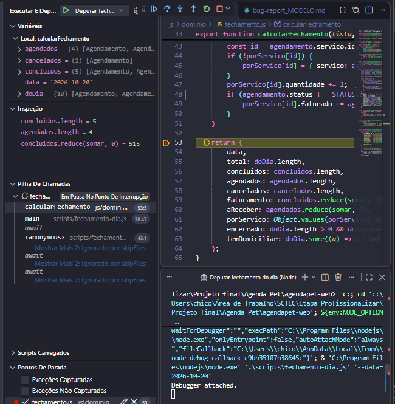

# Relatório de bug — BUG-01

| Campo | Valor |
|---|---|
| **Título** | Faturado por serviço soma atendimentos não concluídos |
| **Ticket relacionado** | US12 – Depuração e relatório de bug |
| **Onde apareceu** | Relatório de fechamento / arquivo `js/dominio/fechamento.js` |
| **Branch da correção** | `fix/US12-depuracao` (Commit `eee9ff1`) |
| **Gravidade** | Alta — O bug gera uma inconsistência crítica de valores, inflando o faturamento da tabela por serviço ao somar atendimentos não concluídos. |

## Passos para reproduzir

1. [ ] Fazer o checkout na branch `fix/US12-depuracao` no commit do erro controlado `c7d62ed` ("test(US12): introduz erro controlado no faturado por serviço").
2. [ ] Executar o comando `npm run fechamento` no terminal de depuração.
3. [ ] Comparar o valor de "Faturamento" apresentado no topo com a soma da coluna "Faturado" de cada serviço da tabela.

## Resultado esperado × obtido

| | Esperado | Obtido (com o bug) |
|---|---|---|
| **Soma da coluna "Faturado" por serviço** | R$ 515,00 (igual ao topo) | R$ 900,00 (maior que o topo) |

## Investigação com o depurador

Configuração usada: **"Depurar fechamento do dia (Node)"** (tecla **F5**).

1. **Breakpoint** em `js/dominio/fechamento.js`, linha do `return {` na função `calcularFechamento`.
2. Variables / Watch:

   | Expressão (Watch) | Valor |
   |---|---|
   | `porServico` (Painel Variables) | `faturado` maior que `concluidos.reduce(somar, 0)` |
   | `concluidos.length` | 5 |
   | `agendados.length` | 4 |
   | `concluidos.reduce(somar, 0)` | R$ 515,00 |

3. **Call Stack:** `calcularFechamento` ← `main` (`scripts/fechamento-dia.js`). Concluiu-se que o fluxo de execução principal invoca corretamente o módulo de fechamento, mas os dados processados na função analisada estão inconsistentes com o esperado na memória.
4. **Breakpoint condicional ou logpoint:** Inserido na linha `porServico[id].faturado += agendamento.calcularValor();` com a condição `agendamento.status === 'Agendado'`. A execução pausou em atendimentos com status "Agendado", provando que eles estavam sendo somados indevidamente no faturamento por serviço.

Evidência:  (docs/depuracao.png)

## Causa raiz

No laço de repetição da função `calcularFechamento`, a condição `if (agendamento.status !== STATUS.cancelado)` permitia a passagem de qualquer agendamento ativo (incluindo os que estavam apenas agendados, mas não concluídos). O correto seria validar estritamente se o status era igual a concluído.

```js
// ANTES (bug)
if (agendamento.status !== STATUS.cancelado) {
    porServico[id].faturado += agendamento.calcularValor();
}

// DEPOIS (correto)
if (agendamento.status === STATUS.concluido) {
    porServico[id].faturado += agendamento.calcularValor();
}
```

## Correção

- Commit ou Pull Request: `fix(US07): soma só atendimentos concluídos no faturado por serviço` (`eee9ff1`)
- Como confirmar que foi corrigido: Rodar novamente o comando `npm run fechamento` e validar se a soma da coluna "Faturado" bate exatamente com o Faturamento do topo (R$ 515,00).

## Como evitar de novo

- [ ] Realizar a conferência manual cruzada do total do relatório com a soma de suas partes individuais antes de subir alterações de fechamento.